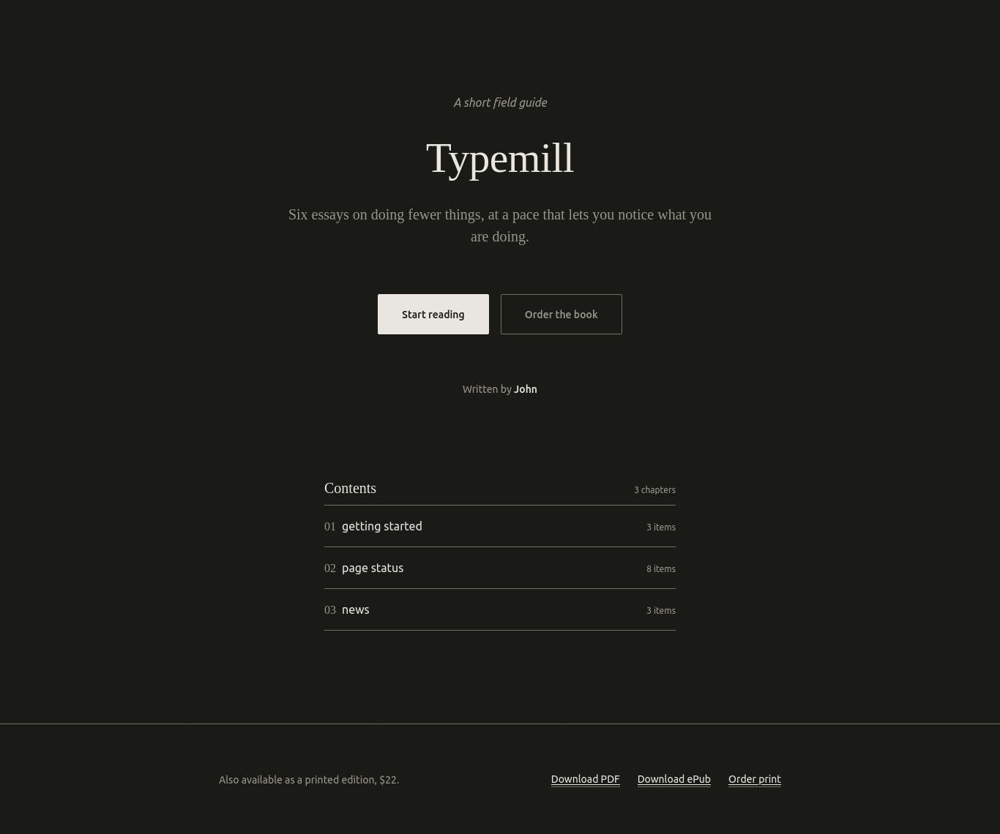

# Soloprint Theme

Soloprint is a minimal, book-like Typemill theme designed for a single publication. It is ideal for publishing a single web book.

If you are planning a publishing platform with multiple publications, please use the [Publisher theme](https://themes.typemill.net/publisher).

## Features

Soloprint includes the following features:

* A landing page with the publication title and table of contents.
* A dark mode button in the header.
* Configurable colors.
* An optional header button for actions such as buying, logging in, or downloading.
* A table of contents button.
* Previous and next page buttons.
* An optional breadcrumb.
* An optional next-page banner.
* A configurable footer.
* A responsive design.
* Checked for security and accessibility.

The theme does not currently support separate templates for glossaries, blogs, or news sections.

## Book Publishing Inspiration

Here are some ideas for enhancing Soloprint when publishing your next web book:

* Use the [Ebook plugin](https://plugins.typemill.net/ebooks) to create PDF and EPUB versions of your book.
* Use the [Register plugin](https://plugins.typemill.net/register) to build a community for your readers.
* Use the [page restriction](https://docs.typemill.net/author-guide/restrict-pages) feature to offer exclusive content to members.
* Use the [Payhip plugin](https://plugins.typemill.net/payhip) to sell your ebook.
* Use the [Newsletter plugin](https://plugins.typemill.net/newsletter) to add a newsletter signup form using Kit or MailerLite.
* Use the configurable header button to let readers order, join, or download your book directly.
* Use [Kixote](https://docs.typemill.net/author-guide/ai-with-kixote) for AI-assisted writing and connect Typemill to AI services such as OpenAI, Claude, or Ollama.

You can also use any of the [other Typemill plugins](https://plugins.typemill.net) to add features such as search and SEO, or to synchronize your ebook content with GitHub.

## Security

Soloprint explicitly escapes all dynamic output in its Twig templates because Typemill disables Twig autoescaping by default. The theme uses context-aware escaping:

* `| e` for HTML text content.
* `| e('html_attr')` for HTML attributes such as `href`, `src`, `id`, `lang`, and meta tag content.
* CSS helper macros that validate theme color values (hex colors) and font stacks before outputting them in `<style>`, falling back to safe defaults for malformed or malicious input.
* `| raw` is reserved for intentionally trusted HTML such as rendered Markdown content and plugin widgets.

## Accessibility

Soloprint aims to meet WCAG 2.1 AA where easily possible:

* Default border and UI colors are chosen to satisfy the 3:1 contrast requirement for user-interface components.
* Body text and muted text colors meet the 4.5:1 contrast requirement.
* A skip link lets keyboard users bypass the header and jump directly to the main content.
* Primary content is wrapped in a `<main id="main">` landmark.
* The breadcrumb is a real `<nav>` landmark with `aria-current="page"` on the active item.
* The table of contents drawer manages focus, closes with `Escape`, and uses `visibility: hidden` when closed so it is removed from the keyboard tab order and accessibility tree.
* Interactive elements have visible `:focus-visible` indicators.
* Decorative SVG icons are hidden from assistive technologies with `aria-hidden="true"` and `focusable="false"`.
* The dark-mode toggle reports its state with `aria-pressed`.

## Configuration

Soloprint provides the following configurable areas in the Typemill theme settings:

* **Landing Page** – title, tagline, kicker, author line, and call-to-action buttons.
* **Elements** – header button, dark mode toggle, breadcrumb, and bottom next-page banner.
* **Colors** – light and dark mode palette (backgrounds, text, accents, borders).
* **Fonts** – serif and sans-serif font stacks.
* **Edition Footer** – footer line and up to three footer links.

## Readymades

Soloprint ships with three readymade presets:

* **Classic** – the original Soloprint look: warm paper, dark ink, and a green accent.
* **Coastal** – a fresh, cool palette with ocean-blue accents on a light paper background.
* **Midnight Reader** – deep charcoal backgrounds, warm off-white text, and amber accents for low-light reading. This preset hides the dark mode switch, the order buttons, the breadcrumb, and the bottom pager because the theme is already dark-first.

Select a readymade in the Typemill theme settings to apply its colors and copy in one click.

## How to Use

Download the theme, unzip it, and place it in the `/themes` folder of your Typemill installation. Then configure and activate the theme in the Typemill theme settings.

## Changelog

### Version 1.1.0

* Make soloprint theme free
* Fix pager
* dark-mode default option
* collapsible navigation (all off by default).
